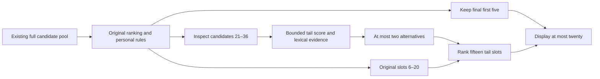

# Completed-candidate scoring and guarded tail recovery

The fixed baseline is 99708f9, whose app matches d857559, version 0.6.39/code 46.
The candidate fails the independent gain gate: all 500 target-hit counts remain
unchanged. Production app/models are restored to the baseline; the new model,
runtime patch and results are research artifacts only.
This work examines correct sentences lost at completed-pool and displayed 20
boundaries. No APK is built. Model selection is frozen before the independent
500 outcomes; calibration alone does not justify an accuracy claim.

## Search and display experiments

The initial protocol tests raw 144 as a widening control, selecting 128 completed
paths using the existing whole-sentence score from raw 192, and retaining raw 128
plus 16 scored alternatives. All three leave first/top5/top20 counts unchanged
on the observed 700 cases: 152/280/362. None qualifies for adoption.

The existing relation scorer categorically preserves its original displayed 20.
Allowing 36 legacy candidates to compete gives 363 top20 hits on 700, but loses
one in the new 100 validation subgroup. On 3,893 known rows, replay yields 43 net
top20 gains but loses one top5 and one written-200 hit. This broad policy fails
the guard criteria. These are observed calibration sets, some overlapping.

Existing-weight tail reserves that preserve first 5 and require lexical support
recover at most two known 3,893 targets and none on 700. Their stronger promotion
conditions are too restrictive to recover many omitted sentences with these
weights. Relaxed alternatives and every tested setting are recorded in the
[protocol](../tools/data/completion_scoring/protocol.json) and calibration
reports, rather than selecting examples by their outcomes.

## Tail-only training

`train_tail_recovery.py` uses the frozen actual native 128-candidate training
observer from 5,381 already attributed training rows. Its SHA-256 is
`7176a2d9c0e8ae4addbb99484e4a3214e7c4abeaa1891264fc3cbd9faad8e6af`.
The fixed existing head model first produces baseline final 20 order. Gold text
is never inserted into a missing candidate pool. Only 47 training rows have
recoverable targets at 21–36, and 75 contribute potential protection targets.
After reachable-margin and feature filtering there are 236 pairs, 234 supported
examples and 41 source families. This is limited supervision, not 5,381 distinct
tail mistakes or a measurement of current Hong Kong typing frequency.

Positive pairs compare a correct outside candidate with the old 20th; negative
pairs compare actual outside mistakes with a correct existing tail candidate.
The loss fits both bounded score margin 0.5 and raw lift 0.5. Source shares are
HK/UD 65%, Tatoeba 20%, authored 15%; recovery/protection class shares are 50/50.
Features need at least two source families, weights are bounded to 1.5, and the
signed correction has strength 1.5/limit 2. Two predeclared regularizers and strict
versus tail-specific lexical evidence are evaluated. No evaluation text or
private phone learning records train the model.

The qualified candidate uses L2=0.015, 460 features and the existing strict
two-relation-kind evidence. Model SHA-256 is
`9a89eec7ff46b4484df7ea598ea912321cf25ba4f864336450c30cca65f141f5`.
Other fitted settings fail a calibration subgroup. Both fitted models and
their exact pairs, weights and reports are retained under
[completion_scoring](../tools/data/completion_scoring/NOTICE.md). Derived
lexicon/weights are CC BY-SA 4.0, with full source attribution retained.

## Rejected candidate behavior

The optional model runs after the existing head and personalization rules.
It keeps the final first five in exactly their existing order, inspects at most
16 alternatives beyond display 20, and can admit at most two into slots 6–20.
A candidate needs raw relation lift ≥ 0.5 and actual corrected score ≥ old 20th + 0.5,
two positive lexical relation kinds and new positive evidence over the old 20th.
Explicit word counts still precede statistical tail scores. There is no second
head promotion. Prefix search, raw completed 128, confidence, glyph/code checks,
dictionary and personal storage remain unchanged.



Missing, wrong-format or corrupt optional models fall back to the existing
decoder. Older constructors keep their original behavior. The native evaluation,
simulated Single and performance drivers explicitly load the new model when
present, avoiding an accidentally untested optional asset.

## Qualification and independent decision

|Observed calibration|Baseline first/top5/top20|Candidate first/top5/top20|
|---|---:|---:|
|700 full native decodes|152/280/362|152/280/363|
|3,893 known native-pool replays|1355/2212/2620|1355/2212/2621|

Every subgroup's first/top5/top20 count is nondecreasing. Tail positions can
still move backward: known 3,893 MRR changes 0.444519→0.444479. The sets overlap
and these tiny calibration gains are not additional independent evidence.
All 700 actual candidate lists exactly match the selected replay. Legacy 20,
wide 36 and the earlier existing-weight tail policy also match their respective
700 actual decode lists, validating the replay's boundary handling.

226 Java tests pass without skips, including exact recovery, first 5 retention,
explicit personal tail priority, insufficient evidence, inspection bounds,
zero-strength behavior and wrong/corrupt-model fallback. Lint has 0 errors and
25 existing warnings. 24 Python checks pass without skips, including training
data isolation and selected fit/pairs/model/report byte-for-byte reproduction.
Simulated three Single confirmations preserve 32/32 first targets and 489 records.

Six inputs, 50 warm-up passes and 31 alternating samples on one desktop CPU give
maximum wall ratio 1.02662 and CPU ratio 1.01424. This passes the 1.2 budget and
does not establish faster recognition, retained phone memory or Fold7 latency.

The [selection](../tools/data/completion_scoring/selection.json), including source,
model, data and protocol hashes, is frozen with reserve outcomes unopened.
The 500 reserve examples were source-family separated before these experiments
and remain words.hk NCDOL 1.0 evaluation-only material. They never train a model
or enter APK assets. Run baseline/candidate once and require a net count gain
without first/top5/top20 count loss; otherwise retain the baseline. No model,
threshold or runtime changes follow the reserve outcome. The entire candidate
is rejected according to that frozen rule; the app is restored rather than
retuned on the newly observed examples.

|Independent 500|Baseline|Candidate|
|---|---:|---:|
|First|86|86|
|Top five|182|182|
|Top twenty|253|253|
|MRR|0.256991|0.256958|

No target enters or leaves these hit groups. One target moves from rank 10 to 12,
so even the small MRR movement is negative. First-five lists are byte-identical
for every input. The selection SHA-256 is
`10fee83266683582c03c8762a134d0f97c77ed541ef8dda6f5660096c1319fbf`.
Its unopened flag records the earlier freeze, not the current reserve status.
These 500 examples are now observed evaluation material and cannot serve as
an unopened test for subsequent tuning.

The key remaining limitation is supervision: only 47 of 5,381 training targets
exercise recoverable positions 21–36, with 41 source families across all usable
recovery/protection pairs. Further tail-model work needs more licensed natural
training examples producing these errors and a new untouched reserve. Reusing
this 500 to select another threshold would not demonstrate an independent gain.

## Reproduction

Use a new or empty archive directory for each tail-runner invocation; it rejects
nonempty directories and the app checkout root to preserve existing files.

```sh
source /workspace/android-environment/activate.sh
python tools/train_tail_recovery.py /path/to/head-observer-training.tsv /tmp/tail-fit --l2 .015
PYTHONPATH=tools python -m unittest tools/test_tail_recovery.py tools/test_head_promotion.py tools/test_phrase_relations.py tools/test_aligned_relations.py tools/test_prefix_retrieval.py
python tools/completion_scoring_trial.py score-cut .native/reproduce-score-cut --cases tools/reports/prefix-retrieval-2026-10-15/calibration700.tsv --output /tmp/score-cut.tsv
python tools/run_tail_recovery_trial.py tools/reports/completion-scoring-2026-10-15/reproduction5-cases.tsv /tmp/tail-smoke.tsv .native/reproduce-tail-smoke
cmp /tmp/tail-smoke.tsv tools/reports/completion-scoring-2026-10-15/reproduction5.tsv
python tools/run_tail_recovery_trial.py tools/data/prefix_retrieval/heldout.tsv /tmp/rejected-tail.tsv .native/reproduce-tail
```

The training observer is regenerated from the fixed 5,381 rows using
`diagnose_sentence_priority.observe` at db4b363, with the search-only PRR3 asset
and 128-pool source preserved in the previous
[search recovery work](SEARCH_RECOVERY.md). The selected runtime patch and
archived experiment generator preserve exact candidate source for review.
Large raw observer caches remain outside version control; reports retain their
hashes and observed/independent status.

The five-case reproduction includes three changed candidate lists and matches
the frozen native outputs byte for byte. The archived tail runner applies the
frozen runtime/test patch and model inside its own tree; the app checkout remains
untouched. The 226-test Java/Lint result
and simulated Single evidence describe that rejected candidate. After restoring
the app, the research Python checks and standalone patch reproduction are
verified separately. No APK, version, signing or learning-storage update ships.
