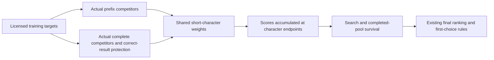

# Expanded error supervision and shared search/final scoring

Baseline: b5b084fa043724f38913a8042b47ffcd551330e8, app version 0.6.39/code 46.
All six fixed configurations fail the calibration guard. Production remains
the baseline, and the new 500-case reserve stays unopened. Shared models and
runtime generation are research artifacts, not bundled or enabled in the app.
The previous tail model could not improve first/top-five by design and had
only 47 recoverable outside-display training targets. This iteration expands
actual-error supervision and lets one decomposable model influence search and
first-choice selection. No APK or 1.0 release is implied by model training.

## Data frozen before decoding

The existing 5,381 attributed rows are retained, with 4,000 previously unused
HKCanCor utterances and 600 Tatoeba train examples: 9,981 ranking targets.
Selection uses source hashes before observing errors. Additions exclude all
known evaluation target substrings of at least six characters. HKCanCor uses
only its original 46 training conversations; Tatoeba uses original training
translation groups. They provide more ranking supervision from already known
language-model source material, not new speakers, recordings or contemporary
chat frequency. Neither target variants nor multiple competitors become
independent family support.

Another 100 validation and 500 reserve examples are frozen from unused words.hk
headword/duplicate/one-edit families, excluding all prior evaluation families,
tracked targets and full-target raw training exposure. These are dictionary
usage examples, not a live typing study. Their NCDOL 1.0 data remain strictly
evaluation-only. Full training/derivative licenses are retained in the
[notice](../tools/data/joint_ranking/NOTICE.md).

## Actual mistakes and protection examples

An archived baseline pass records both at-risk, exactly continuable prefixes
and the actual eligible complete pool, without inserting any known answer.
Targets are classified as correct-first, later-top-five, later-top-twenty,
outside-twenty or missing-from-pool. Missing full targets are not invented as
complete-pool training positives. Their reachable early prefix mistakes may
still supply search training. Correct results supply protection comparisons.
Final comparisons fit the harder of the actual raw-score and adjusted-score
gaps, so a shared correction must address both the entry winner and final
ranking rather than fitting only one of those boundaries.

The observer retains original candidate order/scores. A zero-weight trial must
also reproduce the baseline. All model selection uses validation or previously
observed guards; independent reserve outcomes remain unopened until a frozen
candidate qualifies.

## Shared score



The optional model learns Han bigrams/trigrams only. The same score accumulates
through actual lattice transitions and survives into final ranking; it is not
added a second time after completion. The original first choice is recomputed
from the new paths/scores, rather than freezing the previous run's first five.
Existing head evidence and personal-preference rules still apply.

At most two learned keys close at each character endpoint. Individual weights
are bounded to 0.5, below the existing runtime endpoint limit of 1.5 even when
both occur. This makes the shared linear feature score exactly consistent
under token splitting. Baseline prefix comparison offsets include existing
lookahead, and new scores can change later search choices; the training loss
is therefore not proof of end-to-end improvement. Native evaluation is required.

Training balances prefix/final stages equally and assigns 70% HK/UD, 20%
Tatoeba and 10% authored source mass. Feature support needs three distinct
original conversation/translation/template families. Before any fitting or
candidate decoding, regularizers 0.003/0.015 and inference strengths 0.25/0.5/1
are fixed as six configurations. A final-only control uses the selected shared weights on
the old full pool to distinguish search effects. Full gates are declared in
the [protocol](../tools/data/joint_ranking/protocol.json) before trial outcomes.

## Calibration decision and remaining coverage gap

|Configuration|First / top five / top twenty on 800|
|---|---:|
|Baseline|171 / 324 / 421|
|L2 0.003, strength 0.25|172 / 323 / 421|
|L2 0.003, strength 0.5|171 / 323 / 423|
|L2 0.003, strength 1|170 / 324 / 422|
|L2 0.015, strength 0.25|172 / 323 / 421|
|L2 0.015, strength 0.5|172 / 324 / 422|
|L2 0.015, strength 1|172 / 323 / 422|

The best research setting is 0.015/0.5 by the declared selection order. Its
new 100 validation rows change 19/44/59 to 19/45/60, but the old 700 change
152/280/362 to 153/279/362. The old top-five loss fails the fixed no-loss gate;
the overall tiny gains do not override it. All sets here are calibration,
not independent evidence. No threshold, weights or cases are changed after
these outcomes. No independent reserve result is needed to reject the models.

The fixed final-only control at 0.015/0.5 produces 172/323/422. Joint search
therefore adds one top-five hit over that control and no net first/top-twenty
hits; the shared score does not establish a substantial search improvement.
The control is diagnostic only and also fails the adoption gate.

Actual training observations include 7,100 correct-first targets, 897 later
top-five, 84 later top-twenty, 79 outside-twenty and 1,821 missing full targets.
Of the 4,600 additions, 1,416 are missing, 247 are later and 2,937 already rank
first. These are exposed training rows, not user-accuracy measurements.
There are 37,717 comparisons (17,895 prefix and 19,822 final), with 27,514
supported examples and 1,403 original source families. The two models retain
4,955/4,417 short features; family counts cover all comparison types and are
not comparable to the previous tail-only 41-family figure.

Only 777 of the 1,821 missing targets supply a close observed prefix comparison;
1,044 supply neither one of those comparisons nor a final-pool positive.
Their failure is recorded but has no direct ranking loss in this conservative
training scheme. This does not identify their exact earlier failure point.
Future work should trace these cases and evaluate reconstruction of valid
gold paths for **training-only** structured comparisons, clearly distinguished
from unchanged, answer-free inference and evaluation. Adding more easy corpus
rows or changing a final-display threshold alone does not address this gap.

Data preparation reproduces its seven frozen artifacts byte for byte, and
the 0.003 fit reproduces all seven fitted artifacts byte for byte. Four Python
checks pass without skips. Each model passes 24 Python/Java score comparisons,
177 codepoint token splits and actual decoder score integration checks;
primitive-array memory is 373,236/361,676 bytes. The observation driver matches
all 700 baseline lists exactly, and the zero-weight archive matches five lists.
Android qualification, Single/performance guards and independent 500 decoding
are not advanced for an accuracy-rejected candidate. No physical Fold7 result,
recognition-speed improvement or 1.0 release is claimed.

## Reproduction

Activate `/workspace/android-environment/activate.sh` before Java commands.
Raw pinned sources and large native observers remain in ignored `.native/`;
manifests preserve their hashes. No private phone records are used.

```sh
python tools/prepare_joint_ranking.py /path/wordshk.csv /path/hkcancor-utf8.zip /path/yue_hk-ud-test.conllu
python tools/observe_joint_ranking.py prepare .native/joint-observer
python tools/observe_joint_ranking.py run .native/joint-observer --cases tools/data/joint_ranking/train.tsv --output .native/joint-observations
python tools/train_joint_ranking.py .native/joint-observations/pools.tsv .native/joint-observations/prefix.tsv /tmp/joint-fit
python tools/run_joint_ranking.py prepare .native/joint-trial --model /tmp/joint-fit/joint-0.5.b64
python tools/run_joint_ranking.py run .native/joint-trial --cases tools/data/joint_ranking/validation.tsv --output /tmp/joint-validation.tsv
```

Use new or empty archive directories for observers/trials. They reject existing
files and never patch production app
files. Version, signing, learning storage and Fold7 layout stay unchanged
unless an independently qualified candidate is explicitly integrated later.
